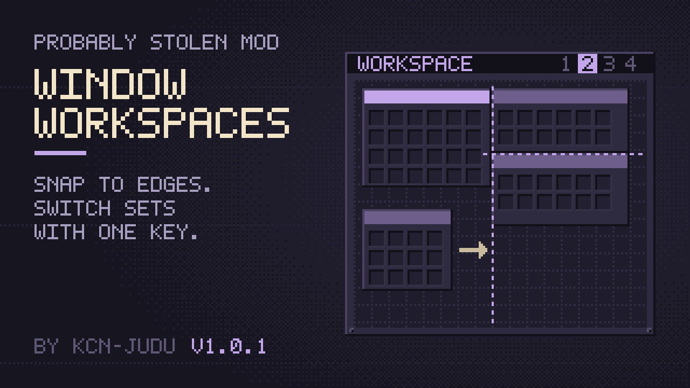

# Window Workspaces



A mod for *Probably Stolen*. Windows snap to each other, to the screen edges and to the inventory grid while you drag them. Workspaces keep several sets of open containers, like virtual desktops, and one key switches between them. The mod has two keys: next workspace and workspace manager.

**Documentation:** <https://kcn-judu.github.io/ProbablyStolen-Mods/en/window-workspaces/> ([简体中文](https://kcn-judu.github.io/ProbablyStolen-Mods/zh-cn/window-workspaces/))

Part of the [Probably Stolen mods collection](https://github.com/KCN-judu/ProbablyStolen-Mods).

## Install

Subscribe on the [Steam Workshop](https://steamcommunity.com/sharedfiles/filedetails/?id=3832565070), or copy the folder from a [release](https://github.com/KCN-judu/ProbablyStolen-WindowWorkspaces/releases) into the game's `Mods` folder. Then enable the mod in the game's Mods menu, restart the game, and bind its two keys in the options menu.

## Build

```bash
./build.sh            # out/window_workspaces
./build.sh --install  # also copies it to the game's Mods folder
```

See [Building](doc/manual/building.md) for the requirements and the `GAME` and `CSC` variables.

## Repository layout

| Path | Contents |
| --- | --- |
| `src/` | The mod's source |
| `Localization/` | In-game text, one file per game language |
| `doc/manual/` | Documentation, in English (the source of every translation) |
| `doc/locale/` | Translations of the documentation, as gettext catalogs |
| `manifest.xml`, `preview.png` | What the game reads, next to the DLL |
| `WORKSHOP.txt` | The Steam Workshop description, in BBCode |
| `CHANGELOG.md` | Changes by version |

## License

[Apache License 2.0](LICENSE).
