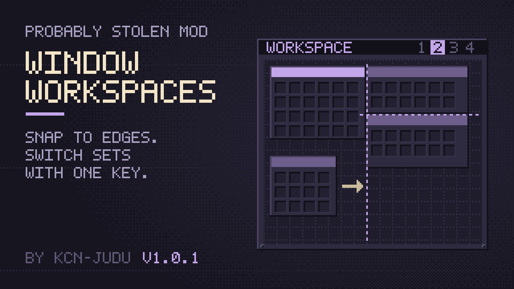

# Window Workspaces

Window Workspaces adds two things for container windows. Windows snap into place while you drag them. Workspaces keep several sets of open containers, and one key switches between them, like virtual desktops.

## Snapping

Drag a window by its title bar as usual. When one of its edges comes close to the edge of another window or of the screen, it snaps there, and a guide line marks the edge it holds. Pull a little further and it lets go.

Away from any edge, the window lines up with a faint grid the size of one inventory cell, so windows sit on the same grid as the items in them. The grid only shows while you drag.

Hold **Alt** while dragging to move a window freely.

## Workspaces

A workspace is a set of open containers, each with its position and selected tab. You start in one workspace, and everything you open belongs to it.

When you switch to another workspace, the windows of the one you leave are remembered and closed, and the windows of the one you enter open where you left them. A new workspace starts empty. Switch to it and open the containers it should hold.

See [Workspaces](workspaces.md) for the manager and the keys.

## Settings

Bind the two keys in the game's options menu, in the key bindings:

| Key | What it does |
| --- | --- |
| Next workspace | Switches to the next workspace. Hold Shift for the previous one. |
| Workspace manager | Opens the window to switch, create, rename and delete workspaces. |

Neither key has a default. The mod's options (the gear in the Mods menu) turn **Snap windows**, **Snap to the grid** and **Show the grid while dragging** on or off. All three are on by default.

## Compatibility

The mod hooks only `PixelWindow.Show`, `Hide` and `Destroy`, to keep a list of open windows, and changes no game behaviour. It works on its own and together with Performance Fixes, which makes switching back to a workspace nearly instant. It needs no special permissions.
